# Report Builder: Dss.Reporting.Symbols, QR codes, barcodes, and actions

Open the website's **Report Builder Guide** menu for the illustrated walkthrough, or **Symbols and actions** for the working DSS preview. These are real Microsoft Report Builder screenshots captured using the fictional demo below.

Download both [GuideDemo.rdl](../api/Reports/docs/GuideDemo.rdl) and [GuideDetails.rdl](../api/Reports/docs/GuideDetails.rdl). Put them under your API's `Reports/docs` folder. The demo uses constants and a String parameter `InvoiceId` defaulting to `1002`; it has no datasets and needs no query-map entry.

## 1. Package, assembly, and report code

- NuGet package: **Bagojikop.Dss.Reporting.Symbols**.
- DLL and report assembly reference: **Dss.Reporting.Symbols**.
- Static helper class: **Dss.Reporting.Symbols.SymbolImages**.
- Target: .NET Standard 2.0. Deploy its resolved dependencies with the host.

```powershell
# ASP.NET Core already brings Symbols as a dependency.
# To use it directly in a separate compatible host:
dotnet add package Bagojikop.Dss.Reporting.Symbols --version 1.0.3
```

Microsoft Report Builder is not a NuGet package manager. ASP.NET Core hosts already get Symbols through the reporting package. For separate SSRS/RDLC hosts, make the Symbols DLL and dependencies available to that host and verify its custom-assembly compatibility. This repository verifies DSS rendering; it does not establish compatibility for every Microsoft host/version.

### Assembly reference

The supplied RDL already contains this reference. For a new report, add it through SSDT Report Designer, or add the following report-level XML fragment and reopen the report:

```xml
<CodeModules>
  <CodeModule>Dss.Reporting.Symbols</CodeModule>
</CodeModules>
```

Right-click outside the report border, select Report Properties, and inspect References if exposed by your version. These methods are static: no Classes instance is needed.

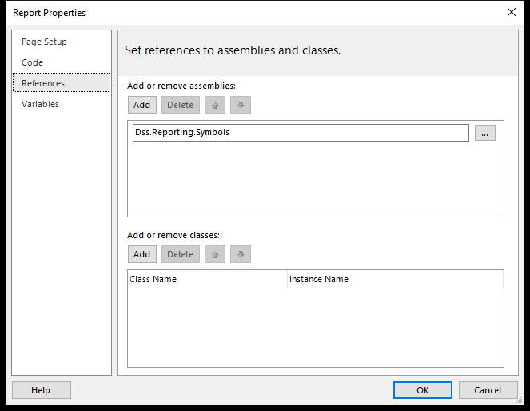

### VB wrappers

Open Report Properties > Code and add:

```vb
Public Function GenerateQRCode(value As String, Optional eccLevel As String = "M", Optional pixelsPerModule As Integer = 4, Optional drawQuietZones As Boolean = True) As Byte()
    Return Dss.Reporting.Symbols.SymbolImages.GenerateQRCode(value, eccLevel, pixelsPerModule, drawQuietZones)
End Function

Public Function StringToQR(value As String, Optional eccLevel As String = "M", Optional pixelsPerModule As Integer = 4, Optional drawQuietZones As Boolean = True) As Byte()
    Return Dss.Reporting.Symbols.SymbolImages.StringToQR(value, eccLevel, pixelsPerModule, drawQuietZones)
End Function

Public Function GenerateBarcode(value As String, Optional width As Integer = 0, Optional height As Integer = 80, Optional margin As Integer = 12, Optional barcodeType As String = "CODE128") As Byte()
    Return Dss.Reporting.Symbols.SymbolImages.GenerateBarcode(value, width, height, margin, barcodeType)
End Function

Public Function GenerateCode39Barcode(value As String, Optional width As Integer = 0, Optional height As Integer = 80, Optional margin As Integer = 12, Optional barcodeType As String = "CODE39") As Byte()
    Return Dss.Reporting.Symbols.SymbolImages.GenerateCode39Barcode(value, width, height, margin, barcodeType)
End Function

Public Function CurrencyInWord(amount As Decimal, currencyCode As String) As String
    Return Dss.Reporting.Symbols.CurrencyWords.CurrencyInWord(amount, currencyCode)
End Function

Public Function Base64ToImage(value As String) As Byte()
    Return Dss.Reporting.Symbols.SymbolImages.Base64ToImage(value)
End Function
```

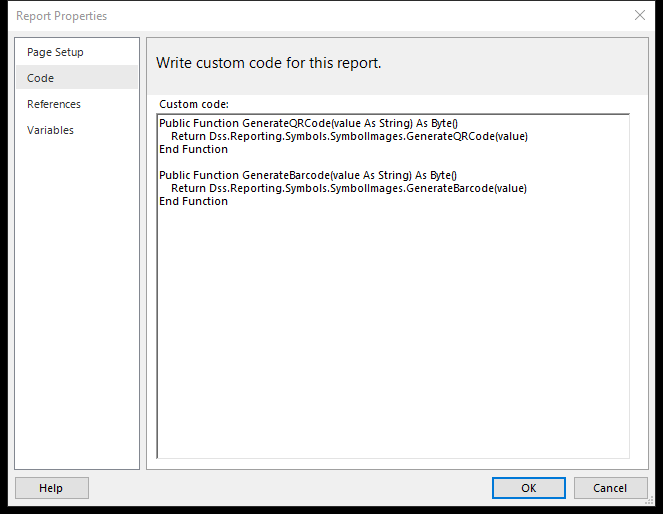

Microsoft documents limitations on custom assemblies in standalone Report Builder, including local preview. The reference screenshot shows an existing reference in the supplied RDL on the installed version. Use SSDT or the supplied RDL when reference authoring is unavailable, then test in DSS. A separate report server needs its own assembly deployment. Power BI paginated reports do not support custom assemblies. See [Microsoft custom-code guidance](https://learn.microsoft.com/en-us/sql/reporting-services/report-design/custom-code-and-assembly-references-in-expressions-in-report-designer-ssrs) and [assembly deployment](https://learn.microsoft.com/en-us/sql/reporting-services/custom-assemblies/deploying-a-custom-assembly).

DSS recognizes the supported Code helper names natively; it does not run arbitrary report VB. The screenshots show authoring settings, not a successful local Microsoft-host preview.

## 2. QR code

1. Insert an Image and open Image Properties > General.
2. Set Source to **Database** and use the Value expression below.
3. Set MIME type to **image/png**.
4. Use a square area with proportional fitting. Save and preview in DSS.

```vb
=Code.GenerateQRCode("DSS-DEMO-1002")
```

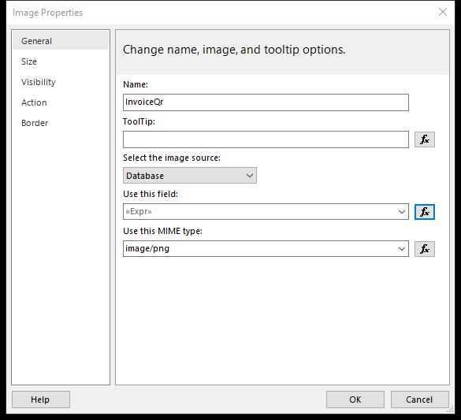

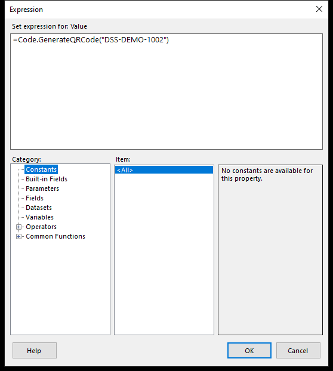

Database means the expression provides image bytes; this static demo does not need a SQL database.

Inside a tablix row:

```vb
=Code.GenerateQRCode(Fields!InvoiceNo.Value)
```

Outside a data region, use a scoped aggregate and your actual RDL dataset name:

```vb
=Code.GenerateQRCode(First(Fields!InvoiceNo.Value, "TextboxActions"))
```

`GenerateQRCode` encodes exactly the supplied text. `StringToQR` first converts UTF-8 text to Base64 and then encodes that Base64 text. Use StringToQR only when the scanning consumer expects that contract.

## 3. Code128 barcode

Insert another image, set Source to **Database**, set MIME type to **image/bmp**, and use:

```vb
=Code.GenerateBarcode("1002")
```

For a dataset row:

```vb
=Code.GenerateBarcode(Fields!InvoiceId.Value & "")
```

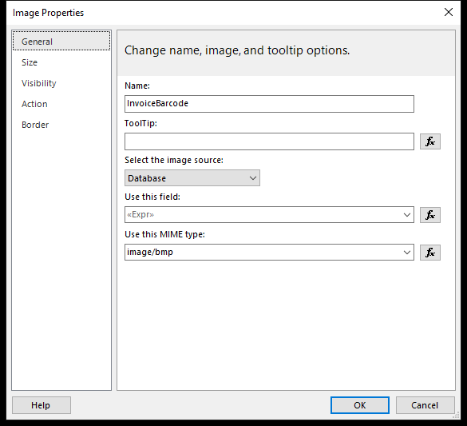

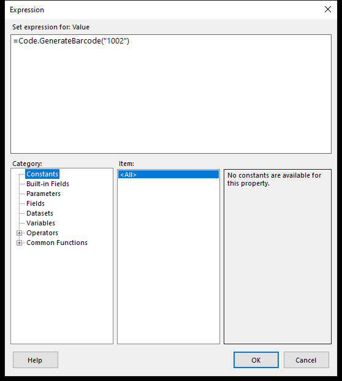

Use a wide image area and preserve aspect ratio and quiet margins. Blank inputs return empty bytes; DSS renders no image. Other hosts may need a visibility expression for optional images. Check scan readability at the final print size.

## 4. Action > Go to report

1. Create GuideDetails.rdl with the target String report parameter InvoiceId.
2. In GuideDemo.rdl, right-click the Open invoice report textbox and select Text Box Properties > Action.
3. Select Go to report and enter **GuideDetails**.
4. Add a parameter named **InvoiceId** and set Value to:

```vb
=Parameters!InvoiceId.Value
```

For a textbox in a dataset row, use this alternative:

```vb
=Fields!InvoiceId.Value
```

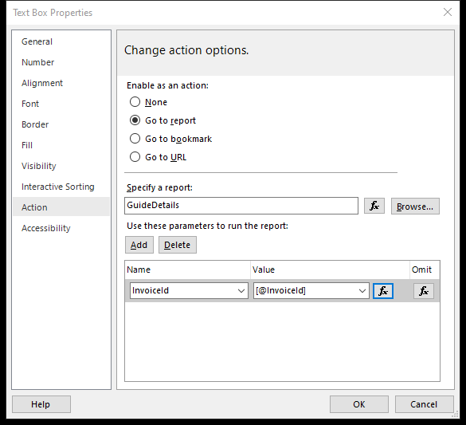

The Name is the target report's parameter; Value is evaluated in the source report/row. In DSS, GuideDetails resolves beside docs/GuideDemo.rdl as docs/GuideDetails.rdl. Deploy target templates and map any target datasets. A leading slash resolves from ReportRoot.

DssReportTabsComponent opens a viewer tab. A standalone viewer requires your reportAction handler. Microsoft SSRS has its own report deployment/navigation behavior. See [Microsoft drillthrough instructions](https://learn.microsoft.com/en-us/sql/reporting-services/report-design/add-a-drillthrough-action-on-a-report-report-builder-and-ssrs).

## 5. Action > Go to URL

1. Right-click Open invoice form and choose Text Box Properties > Action.
2. Select Go to URL and click fx beside Select URL.
3. Enter this expression and save:

```vb
="/forms/invoice/" & System.Uri.EscapeDataString(Parameters!InvoiceId.Value) & "?firmId=2"
```

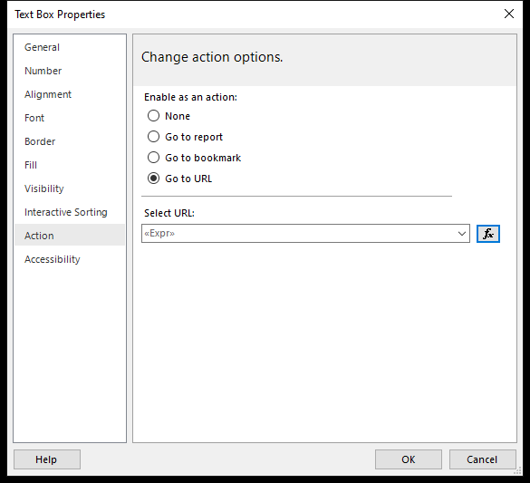

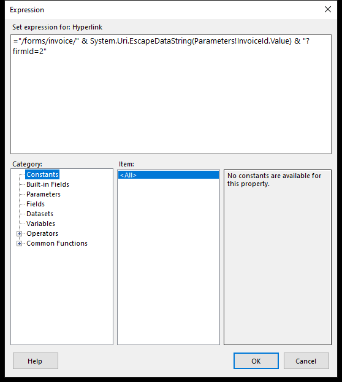

For a clicked dataset row, URL-encode each value:

```vb
="/forms/invoice/" & System.Uri.EscapeDataString(Fields!InvoiceId.Value) &
 "?firmId=" & System.Uri.EscapeDataString(Fields!FirmId.Value) &
 "&customer=" & System.Uri.EscapeDataString(Fields!CustomerName.Value)
```

Report Builder stores the hyperlink expression; the Angular host owns the form. Register an internal route in urlActionRoutes to open a modal, or handle urlAction with your own dialog integration. External HTTP(S) actions are emitted to the host. See [Microsoft hyperlink instructions](https://learn.microsoft.com/en-us/sql/reporting-services/report-design/add-a-hyperlink-to-a-url-report-builder-and-ssrs).

## 6. Angular host: report tabs and form routes

Register HttpClient and your API URL token from app.config.json as described in the integration guide. Use the sample InvoiceActionFormComponent, or provide your own form with the mapped inputs.

```typescript
import {Component, inject} from '@angular/core';
import {DssReportTabsComponent, ReportUrlActionRoute} from '@bagojikop/report-viewer';
import {REPORT_API_URL} from '../report-api.config';
import {InvoiceActionFormComponent} from './invoice-action-form.component';

@Component({
  selector: 'app-report-builder-demo',
  standalone: true,
  imports: [DssReportTabsComponent],
  template: `<dss-report-tabs
    [apiUrl]="apiUrl"
    reportName="docs/GuideDemo.rdl"
    [reportParameters]="parameters"
    [urlActionRoutes]="formRoutes"
    rootTabTitle="Symbols and actions"
    height="700px" />`,
})
export class ReportBuilderDemoComponent {
  // Host token provided from app.config.json; see Getting Started.
  readonly apiUrl = inject(REPORT_API_URL);
  readonly parameters = {InvoiceId: '1002'};
  readonly formRoutes: ReportUrlActionRoute[] = [{
    path: '/forms/invoice/:id',
    component: InvoiceActionFormComponent,
    title: 'Invoice form',
    inputs: action => ({
      invoiceId: action.pathParams['id'],
      firmId: action.queryParams['firmId'] ?? '',
      customer: action.queryParams['customer'] ?? '',
      amount: action.queryParams['amount'] ?? '',
    }),
  }];
}
```

The form declares:

```typescript
// Inputs on the host-owned InvoiceActionFormComponent:
@Input() invoiceId = '';
@Input() firmId = '';
@Input() customer = '';
@Input() amount = '';
```

Select Open invoice report to open the target tab. Return to the source and select Open invoice form to open the modal with InvoiceId 1002 and firmId 2. The demo form changes local state only; it does not save to a database. PDF/Word/Excel exports preserve the symbols but do not launch Angular forms.

## Actual DSS preview and action results

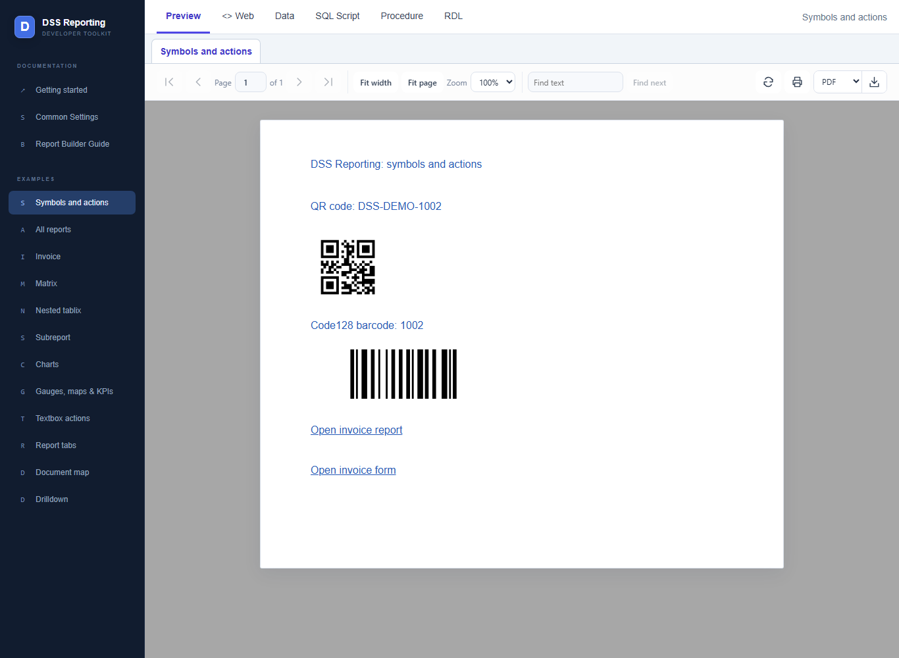

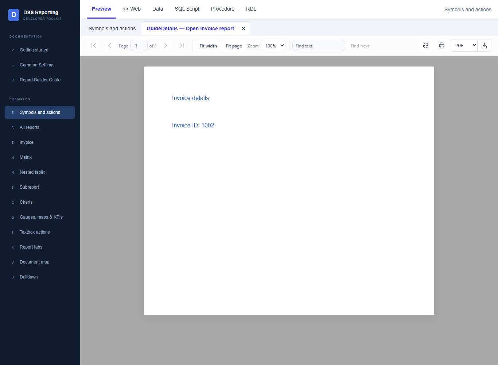

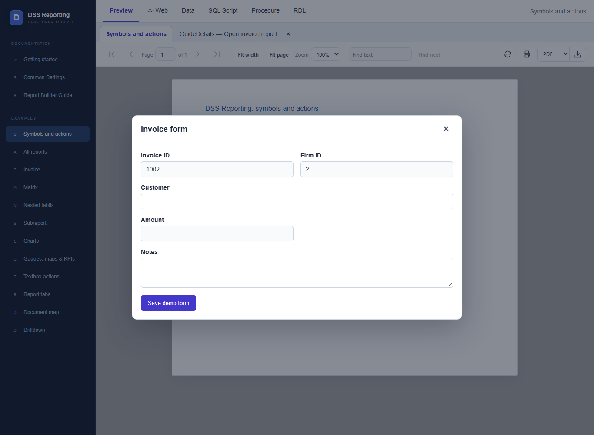

## Verification

The guide includes a live **Symbols and actions** sample. Scan the QR output to read DSS-DEMO-1002 and the Code128 output to read 1002. Check the same output after PDF export and at the intended printed size. The report engine smoke suite also covers QR/barcode payloads and export image embedding. Standalone Microsoft Report Builder preview, SSRS deployment, and third-party RDLC hosting require separate validation.

DSS Reporting is independent software and is not an official Microsoft product.


## Currency and image options demo

[SymbolOptions.rdl](../api/Reports/docs/SymbolOptions.rdl) demonstrates all current helper improvements without datasets. Choose **Currency and image options** in the sample viewer, edit settings, and select **Apply**. The other selector option retains the original symbols and report-actions demo. The Web/RDL tabs include the source for both.

These options are source updates, not a claim that Symbols 1.0.3 already contains them. In the combined source checkout, the sample API can reference the local reporting project with UseLocalDssReporting=true. To make that choice explicit:

```powershell
dotnet run --project sample-repositories/dss-report-viewer-samples/api -p:UseLocalDssReporting=true
```

A separately cloned sample uses its package reference. Deploy an updated reporting package and Symbols DLL before using the new demo there. Do not enable the local-project option unless the reporting source is present at the relative project path.

| Helper | Defaults and options |
| --- | --- |
| GenerateQRCode / StringToQR | ECC M; 4 pixels/module; quiet zones True. Override with L/M/Q/H, 1?32 pixels/module, and a Boolean. StringToQR retains base64 payload encoding. |
| GenerateBarcode | Automatic width (0), height 80, margin 12, CODE128. Width 0 or 1?8192; height 1?2048; margin 0?1024; types CODE128/CODE39/CODE39Extended. Output is BMP without a text label; minimum module width can enlarge the image. |
| GenerateCode39Barcode | Same barcode options, default CODE39. Existing Convert wrappers keep the original format. |
| CurrencyInWord | Amount plus ISO currency code; 165 supported codes. English output; INR uses lakh/crore, other codes use million/billion. Currency precision controls rounding; common codes have named subunits and others use Minor Units. .NET overloads accept decimal, double and int. |
| Base64ToImage | Raw base64 or base64 image data URI; returns unchanged decoded bytes. Use Database image source with the matching MIME type. Blank input produces no image. |

```vb
=Code.GenerateQRCode(Fields!SignedQRCode.Value, "H", 8, True)
=Code.GenerateBarcode(Fields!AckNo.Value, 640, 120, 24, "CODE128")
=Code.CurrencyInWord(Fields!NetAmount.Value, Fields!CurrencyCode.Value)
=Code.Base64ToImage(Fields!Logo.Value)
```

Omitted arguments keep the defaults; supplied invalid arguments produce native report warnings. Existing RupeesToWord and getimgData wrappers remain compatible and delegate to shared helpers. Obsolete ConvertHundreds/ConvertTens/ConvertDigit implementations and BarcodeLib/QRCodeNet references have been removed from migrated sample reports. Existing `Fields!SignedQRCode.Value <> Nothing` expressions are supported as standalone comparisons too.
