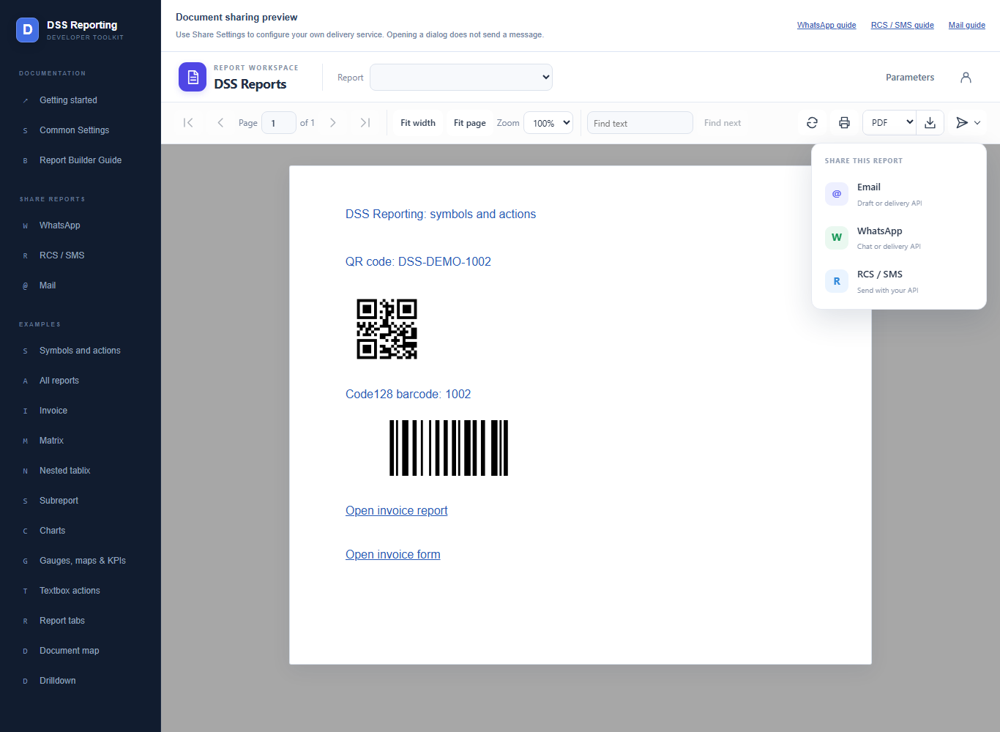
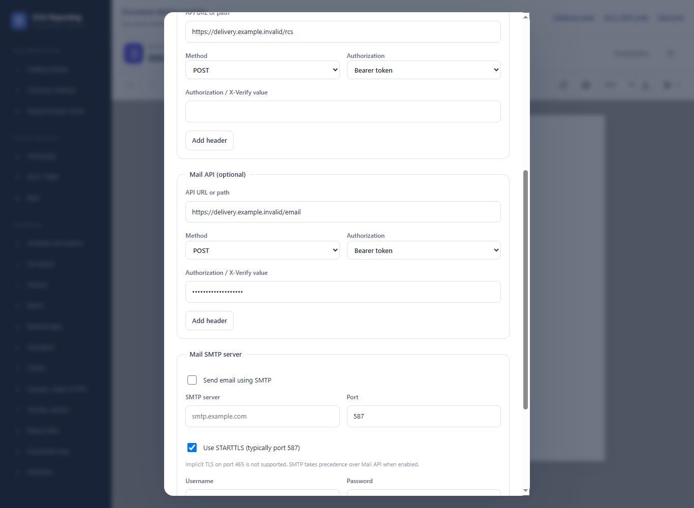
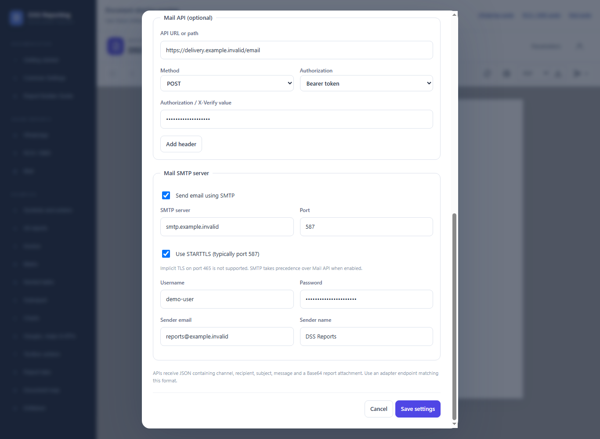
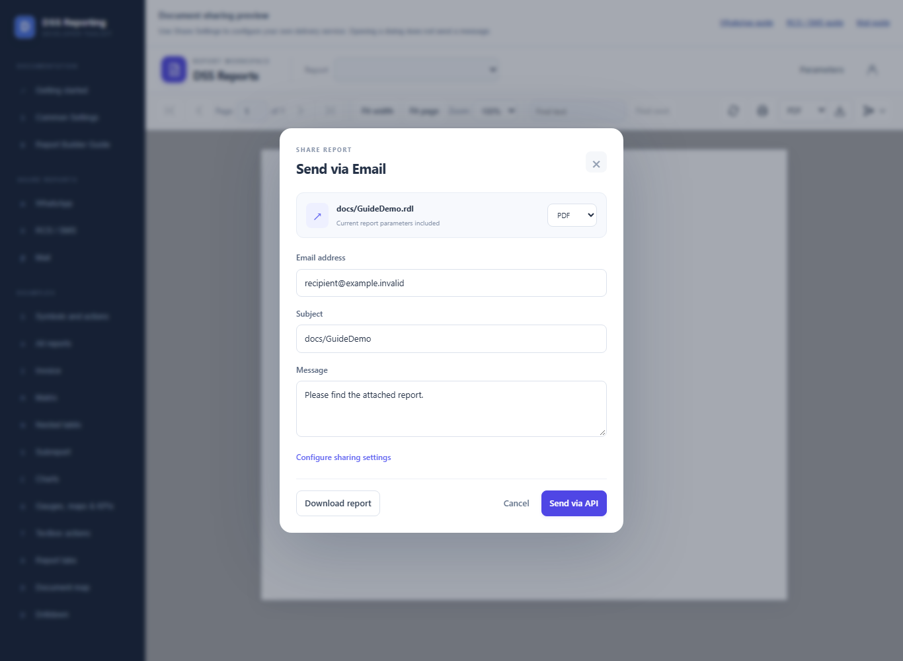

# Share via Mail

> **Live delivery is not yet tested.** Source code and configuration examples are available. Checks cover viewer controls and local mocks only; real WhatsApp, RCS/SMS, Mail API, and SMTP delivery require provider-specific testing before production use.


Send the report as an email attachment through your Mail API or SMTP server, or open an email draft and attach the downloaded report manually.

Open **Share Reports > Mail** in the website sidebar for this guide, or use its Open sharing preview link to try the viewer controls. Screenshots use fictional recipients and reserved domains. No messages were submitted while capturing them.

## Enable the viewer controls

```html
<!-- Import DssReportViewerComponent and register HttpClient in your host. -->
<dss-report-viewer
  [apiUrl]="apiUrl"
  reportName="docs/GuideDemo.rdl"
  [reportParameters]="parameters"
  [showHeader]="true"
  [showSend]="true"
  height="700px" />

<!-- For report tabs, set the same inputs on dss-report-tabs. -->
```

Register HttpClient and load apiUrl from aa.config.json as described in Getting Started. showSend defaults to false; server sharing must also be enabled.



## Configure Mail API (optional)

Open the viewer's account/settings icon, enable sharing, complete the Mail API (optional) section, and save.



Example PUT /api/share-settings payload:

```json
{
  "enabled": true,
  "whatsapp": {
    "url": "",
    "method": "POST",
    "authorization": "none",
    "token": "",
    "headers": []
  },
  "rcs": {
    "url": "",
    "method": "POST",
    "authorization": "none",
    "token": "",
    "headers": []
  },
  "email": {
    "url": "https://delivery.example.invalid/mail",
    "method": "POST",
    "authorization": "bearer",
    "token": "YOUR_SERVER_TOKEN",
    "headers": []
  },
  "smtpEnabled": false
}
```

Merge existing channel and SMTP settings before updating; PUT is not a partial channel patch. Settings are saved on the server; browser send requests cannot override the saved connection details.

## SMTP alternative

Select Send email using SMTP and enter server, port, credentials, and sender details. Merge this section into your saved settings:

```json
{
  "smtpEnabled": true,
  "smtp": {
    "host": "smtp.example.invalid",
    "port": 587,
    "enableSsl": true,
    "username": "YOUR_SMTP_USERNAME",
    "password": "YOUR_SMTP_PASSWORD",
    "fromAddress": "reports@example.invalid",
    "fromName": "Reporting"
  }
}
```



## Share the report

1. Open Share Settings and enable sharing.
2. Configure Mail API with an adapter endpoint and credentials, or enable Send email using SMTP and complete its server and sender details; save settings.
3. Open the report and parameters, then choose Send > Email.
4. Enter the email address, subject, message, and attachment format.
5. Select Send via API or Send via SMTP. With neither configured, Open email draft opens your mail app; attach a downloaded copy manually.



Without a Mail API or SMTP configuration, Email opens a mailto draft containing the recipient, subject, and message. The report is not attached automatically.

SMTP takes precedence over Mail API when smtpEnabled is true. STARTTLS is supported, commonly on port 587; implicit TLS on port 465 is not supported by this implementation.

Supported attachment formats are PDF, Word, Excel, CSV, and HTML. The attachment uses the report name and parameters; it does not include viewer zoom or expanded drilldown state.

## API and adapter

Example POST /api/reports/send/docs/GuideDemo.rdl:

```json
{
  "channel": "email",
  "recipient": "recipient@example.invalid",
  "apiEndpoint": "https://delivery.example.invalid/mail",
  "subject": "Invoice 1002",
  "message": "Please find the attached report.",
  "format": "pdf",
  "parameters": {
    "InvoiceId": "1002"
  }
}
```

The controller uses the saved endpoint and credentials. Your adapter receives a Base64 attachment and must translate it for your provider. A successful response means acceptance, not confirmed recipient delivery. Check provider status before retrying after a timeout.

For the complete adapter payload, SMTP behavior, encrypted settings storage, and data-protection key setup, see the [common sharing reference](share-documents.md).
