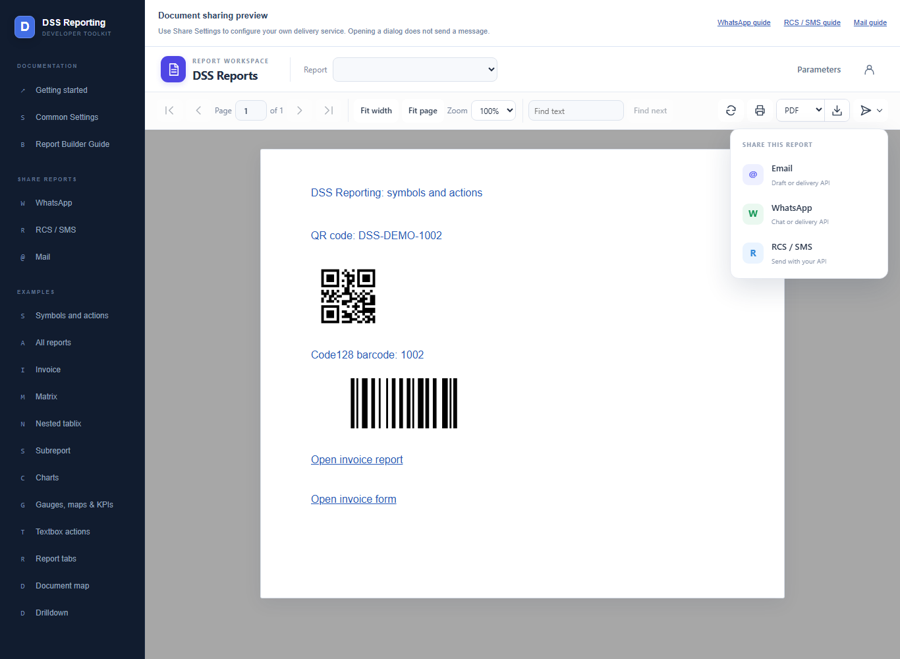
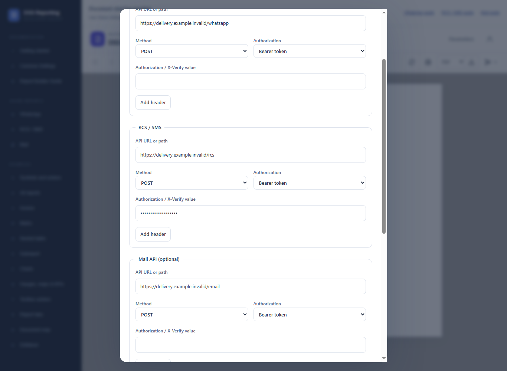
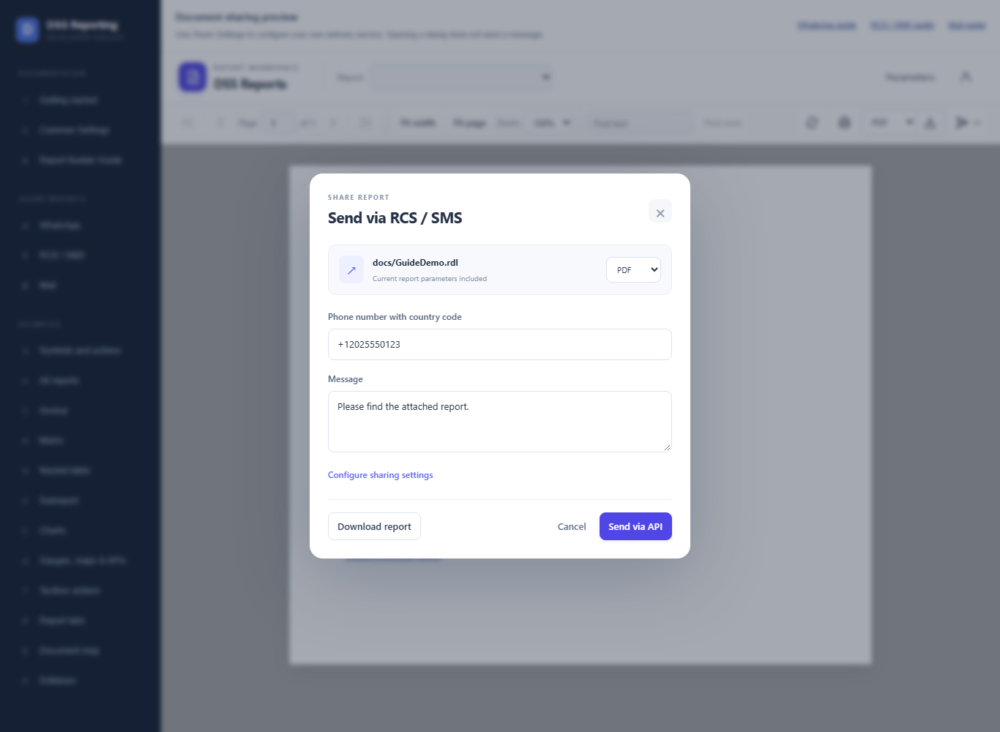

# Share via RCS / SMS

> **Live delivery is not yet tested.** Source code and configuration examples are available. Checks cover viewer controls and local mocks only; real WhatsApp, RCS/SMS, Mail API, and SMTP delivery require provider-specific testing before production use.


Send a generated report to an RCS/SMS adapter. A configured delivery API is required; there is no browser draft fallback.

Open **Share Reports > RCS / SMS** in the website sidebar for this guide, or use its Open sharing preview link to try the viewer controls. Screenshots use fictional recipients and reserved domains. No messages were submitted while capturing them.

## Enable the viewer controls

```html
<!-- Import DssReportViewerComponent and register HttpClient in your host. -->
<dss-report-viewer
  [apiUrl]="apiUrl"
  reportName="docs/GuideDemo.rdl"
  [reportParameters]="parameters"
  [showHeader]="true"
  [showSend]="true"
  height="700px" />

<!-- For report tabs, set the same inputs on dss-report-tabs. -->
```

Register HttpClient and load apiUrl from aa.config.json as described in Getting Started. showSend defaults to false; server sharing must also be enabled.



## Configure RCS / SMS

Open the viewer's account/settings icon, enable sharing, complete the RCS / SMS section, and save.



Example PUT /api/share-settings payload:

```json
{
  "enabled": true,
  "whatsapp": {
    "url": "",
    "method": "POST",
    "authorization": "none",
    "token": "",
    "headers": []
  },
  "rcs": {
    "url": "https://delivery.example.invalid/rcs",
    "method": "POST",
    "authorization": "bearer",
    "token": "YOUR_SERVER_TOKEN",
    "headers": []
  },
  "email": {
    "url": "",
    "method": "POST",
    "authorization": "none",
    "token": "",
    "headers": []
  },
  "smtpEnabled": false
}
```

Merge existing channel and SMTP settings before updating; PUT is not a partial channel patch. Settings are saved on the server; browser send requests cannot override the saved connection details.

## Share the report

1. Open Share Settings and enable sharing.
2. In RCS / SMS, enter your adapter endpoint, choose POST, PUT, or PATCH, and configure the required authorization and headers; save settings.
3. Open the report with its parameters, then choose Send > RCS / SMS.
4. Enter the recipient phone number with country code, choose the report format, and enter the message.
5. Select Send via API. Your adapter sends supported media or creates an appropriate download link for its messaging service.



An RCS/SMS API endpoint is mandatory. The viewer keeps delivery unavailable when the endpoint is empty; there is no draft fallback.

The adapter receives the report bytes as Base64. It is responsible for deciding how to deliver them through your messaging provider. For SMS, it can store the document and send a permitted download link; the library does not create that link itself.

Supported attachment formats are PDF, Word, Excel, CSV, and HTML. The attachment uses the report name and parameters; it does not include viewer zoom or expanded drilldown state.

## API and adapter

Example POST /api/reports/send/docs/GuideDemo.rdl:

```json
{
  "channel": "rcs",
  "recipient": "+12025550123",
  "apiEndpoint": "https://delivery.example.invalid/rcs",
  "subject": "Invoice 1002",
  "message": "Please find the attached report.",
  "format": "pdf",
  "parameters": {
    "InvoiceId": "1002"
  }
}
```

The controller uses the saved endpoint and credentials. Your adapter receives a Base64 attachment and must translate it for your provider. A successful response means acceptance, not confirmed recipient delivery. Check provider status before retrying after a timeout.

For the complete adapter payload, SMTP behavior, encrypted settings storage, and data-protection key setup, see the [common sharing reference](share-documents.md).
