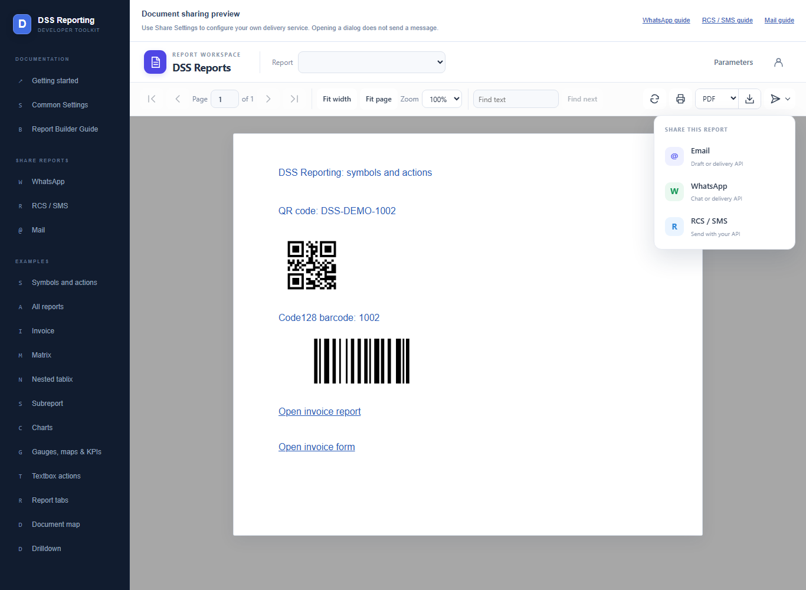
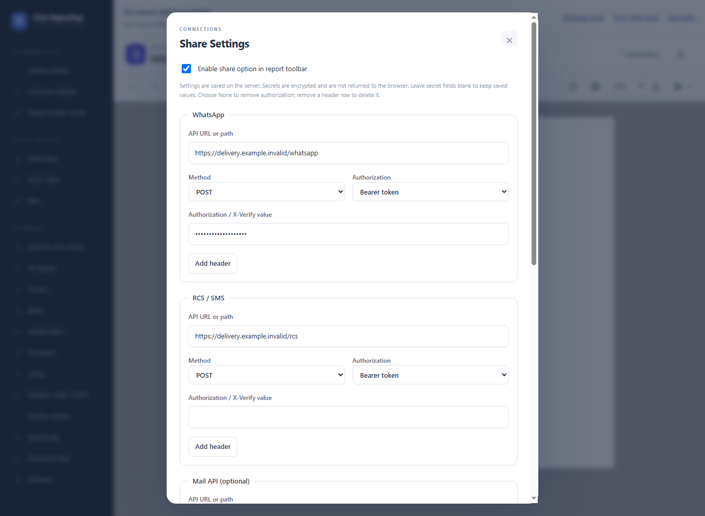
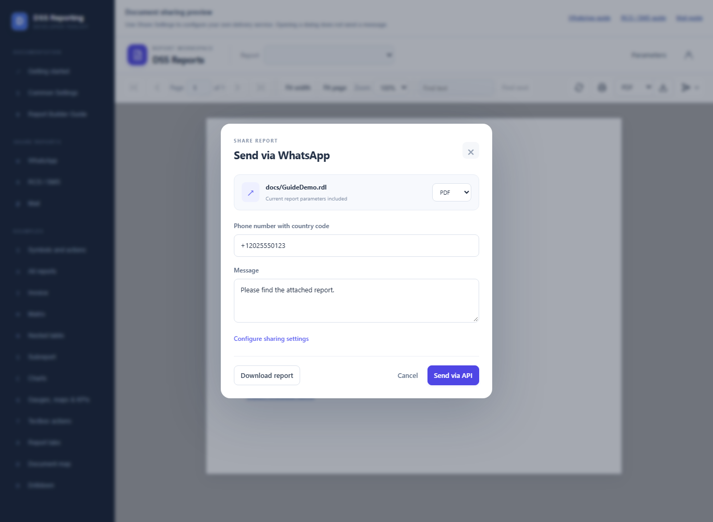

# Share via WhatsApp

> **Live delivery is not yet tested.** Source code and configuration examples are available. Checks cover viewer controls and local mocks only; real WhatsApp, RCS/SMS, Mail API, and SMTP delivery require provider-specific testing before production use.


Send a generated report through your WhatsApp delivery adapter, or open a WhatsApp draft and attach the downloaded file manually.

Open **Share Reports > WhatsApp** in the website sidebar for this guide, or use its Open sharing preview link to try the viewer controls. Screenshots use fictional recipients and reserved domains. No messages were submitted while capturing them.

## Enable the viewer controls

```html
<!-- Import DssReportViewerComponent and register HttpClient in your host. -->
<dss-report-viewer
  [apiUrl]="apiUrl"
  reportName="docs/GuideDemo.rdl"
  [reportParameters]="parameters"
  [showHeader]="true"
  [showSend]="true"
  height="700px" />

<!-- For report tabs, set the same inputs on dss-report-tabs. -->
```

Register HttpClient and load apiUrl from aa.config.json as described in Getting Started. showSend defaults to false; server sharing must also be enabled.



## Configure WhatsApp

Open the viewer's account/settings icon, enable sharing, complete the WhatsApp section, and save.



Example PUT /api/share-settings payload:

```json
{
  "enabled": true,
  "whatsapp": {
    "url": "https://delivery.example.invalid/whatsapp",
    "method": "POST",
    "authorization": "bearer",
    "token": "YOUR_SERVER_TOKEN",
    "headers": []
  },
  "rcs": {
    "url": "",
    "method": "POST",
    "authorization": "none",
    "token": "",
    "headers": []
  },
  "email": {
    "url": "",
    "method": "POST",
    "authorization": "none",
    "token": "",
    "headers": []
  },
  "smtpEnabled": false
}
```

Merge existing channel and SMTP settings before updating; PUT is not a partial channel patch. Settings are saved on the server; browser send requests cannot override the saved connection details.

## Share the report

1. Open the report and set its parameters.
2. Open Share Settings and enable sharing. In the WhatsApp section, enter your adapter endpoint, method, and authentication; save settings.
3. Choose Send > WhatsApp and enter the recipient phone number with country code.
4. Choose PDF, Word, Excel, CSV, or HTML and enter the message.
5. Select Send via API for configured delivery. Without an endpoint, Open WhatsApp opens a draft; download and attach the file yourself.



Without a WhatsApp delivery endpoint, the viewer opens a wa.me draft. It does not automatically attach the report. Use Download report and attach the file manually.

The reporting API sends a Base64 attachment to your adapter. The adapter must translate that payload for your WhatsApp provider; a provider URL alone does not translate its request format.

Supported attachment formats are PDF, Word, Excel, CSV, and HTML. The attachment uses the report name and parameters; it does not include viewer zoom or expanded drilldown state.

## API and adapter

Example POST /api/reports/send/docs/GuideDemo.rdl:

```json
{
  "channel": "whatsapp",
  "recipient": "+12025550123",
  "apiEndpoint": "https://delivery.example.invalid/whatsapp",
  "subject": "Invoice 1002",
  "message": "Please find the attached report.",
  "format": "pdf",
  "parameters": {
    "InvoiceId": "1002"
  }
}
```

The controller uses the saved endpoint and credentials. Your adapter receives a Base64 attachment and must translate it for your provider. A successful response means acceptance, not confirmed recipient delivery. Check provider status before retrying after a timeout.

For the complete adapter payload, SMTP behavior, encrypted settings storage, and data-protection key setup, see the [common sharing reference](share-documents.md).
